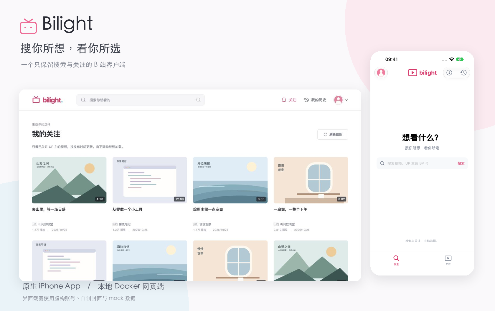

<p align="center"></p>
<h1 align="center">Bilight</h1>
<p align="center"><strong>搜你所想，看你所选。</strong></p>
<p align="center">一个只保留搜索与关注的 B 站客户端。原生 iPhone App，也可以用 Docker 在电脑本地运行。</p>
<p align="center">
  
  
  <a href="LICENSE"></a>
</p>
<p align="center"><a href="#为什么做-bilight">初衷</a> · <a href="#界面预览">界面</a> · <a href="#快速开始">开始使用</a> · <a href="ios/README.md">iPhone 安装</a> · <a href="docs/docker.md">Docker 部署</a></p>



## 为什么做 Bilight

本来只是想搜一个视频，打开首页，却被推荐带到了另一个地方。一个接着一个，最后忘记了自己为什么打开 B 站。

Bilight 的起点很简单：**我想继续看 B 站，但想由自己决定看什么。**

打开后，只有一个搜索框。想看什么就搜，想跟进谁就关注谁。保留视频、UP 主、合集、收藏和观看历史这些有明确目的的入口，去掉推荐、热搜、榜单和自动连播。视频结束，就停在那里。

它不是一个让人刷得更久的客户端，而是希望让“看完了”重新成为一个自然的结束。

## 界面预览

以下均为实际页面截图，使用**虚构账号、mock 内容和项目自制封面**，不包含任何真实账号、关注关系或观看记录。演示模式与正常运行隔离，不能登录、播放或提交互动。

| iPhone 首页 | 关注动态 | 我的账号 |
| :---: | :---: | :---: |
|  |  |  |

<details>
<summary>查看电脑端：首页与 UP 主合集</summary>


</details>

## 可以做什么

| 功能 | iPhone App | 电脑端网页 |
| :--- | :--- | :--- |
| 搜索视频、UP 主、BV 号或链接 | ✓ | ✓ |
| 关注内容 | 视频、文字、图文、转发等动态，单列浏览 | 关注视频，多列网格整行加载 |
| UP 主投稿、合集和列表 | ✓ | ✓ |
| 关注／取消关注 UP 主 | ✓ | — |
| 原生／本地页面播放、画质、倍速、分 P、字幕 | AVPlayer，横屏全屏 | ArtPlayer + DASH，全屏与键盘快进 |
| 点赞、投币、收藏 | 一键三连 | 独立操作、收藏夹选择、长按点赞三连 |
| 我的账号 | 关注的人、常访问 UP、收藏、下载 | 登录账号与退出 |
| 云端观看历史与真实进度同步 | ✓ | ✓ |
| 视频下载、App 内离线播放与文件导出 | ✓ | — |
| 评论 | 只读 | 只读 |
| 弹幕 | 暂未提供 | 只读，可开关 |

两端默认使用账号实际可用的最高 AVC 画质，有字幕时默认开启并优先中文，手动播放、手动切换分 P。网页弹幕默认关闭。会员、地区和平台风控限制如实显示；当前聚焦普通 UP 主视频，不包含直播和番剧。

**iPhone 完全独立运行**，不需要 Mac 或 Docker 常驻。两端分别登录同一个 B 站账号即可读取同一份云端视频历史；实际播放后会同步进度，打开或刷新历史时读取云端更新。UP 主常访问排序也来自 B 站，但不等于逐次主页访问时间线。

## 快速开始

### 电脑端：Docker

需要 Docker Compose；macOS 可以使用 OrbStack。先克隆项目，然后生成**自己的本地加密密钥**再启动：

```bash
git clone https://github.com/Tiresiasel/bilight.git
cd bilight
# 这一步只需本机有 Node.js；不会覆盖已经生成的密钥。
node scripts/setup.mjs
docker compose up -d --build
```

打开 **http://127.0.0.1:3880**，扫码或短信登录已有的 B 站账号。服务只绑定本机地址，不需要额外注册 Bilight 账号。在 OrbStack 上也可使用 **http://bilibili.local**。

没有 Node.js 时，也可以在仓库目录用一次性容器生成密钥：

```bash
docker run --rm -v "$PWD:/work" -w /work node:24-bookworm-slim node scripts/setup.mjs
docker compose up -d --build
```

更新、停止、备份与恢复见 [Docker 使用说明](docs/docker.md)。Safari 自动跳转配置见 [浏览器入口](docs/safari-redirect.md)；本地域名与真正 `bilibili.com` 的区别见 [域名说明](docs/local-domain.md)。

### iPhone：Xcode 构建

需要 macOS、支持 iOS 17 及以上的 Xcode 和 Apple ID。打开 `ios/Bilight.xcodeproj`，选择 Bilight target，在 **Signing & Capabilities** 中选择自己的 Team，并将 Bundle Identifier 改成自己的唯一标识。选择 iPhone 后运行；首次真机安装按系统提示完成开发者模式与信任。

手机端使用 App 内官方登录页，凭据保存在这台 iPhone 的 Keychain。**不需要启动电脑端服务，也不需要把 Mac 的 Cookie 复制到手机。**

[发布页](https://github.com/Tiresiasel/bilight/releases) 提供完整源码包（含 iOS 工程与 Docker 方案）及未签名 IPA。未签名 IPA 供自行签名使用，不能直接点击安装；项目目前没有 App Store 或 TestFlight 版本。详细步骤见 [iPhone 使用与构建](ios/README.md)。

## 本地开发

网页使用 Node.js 24，与 Docker 镜像版本保持一致：

```bash
npm ci
npm run setup
npm run dev
```

前端位于 `http://127.0.0.1:5173`，API 位于 `http://127.0.0.1:3880`。不要与已占用 3880 的 Docker 服务同时启动本地后端。生产构建使用 `npm run build && npm start`。

```bash
npm test
npm run build
bash ios/scripts/verify.sh test
```

iOS 模拟器名称按本机情况通过 `BILIGHT_DESTINATION` 指定。测试默认隔离账号与网络，不发送真实短信或互动；联网播放烟测为单独、显式的命令。目录结构与贡献方式见 [贡献指南](CONTRIBUTING.md)。

## 隐私与演示数据

网页凭据在本地服务端以 AES-256-GCM 加密写入 SQLite，密钥独立挂载；iPhone 凭据只保存在本机 Keychain。仓库和发布文件不包含 Cookie、个人密钥、Apple 签名证书、设备描述文件或真实账号截图。

项目不再维护独立本机视频历史，旧记录也不会批量补报。进度同步依赖登录与网络；失败会显示真实错误，仅在当前页面／App 会话暂存待发进度，不保证断网并终止进程后的补同步。

希望试改界面、录屏或补充文档时，可使用 [离线 mock 预览](docs/demo.md)，无需登录任何账号。

## 技术与致谢

网页：React、Vite、TypeScript、Fastify、SQLite；播放器使用 [ArtPlayer](https://github.com/zhw2590582/ArtPlayer)、[dash.js](https://github.com/Dash-Industry-Forum/dash.js) 和 ArtPlayer 弹幕插件。iPhone：SwiftUI、AVFoundation、WebKit、Keychain。

专注观看的思路也参考了 [FocuBili](https://github.com/L1Xu4n/FocuBili)，没有整体移植其实现。README 的信息结构参考 [ArtPlayer](https://github.com/zhw2590582/ArtPlayer) 与 [Immich](https://github.com/immich-app/immich)，界面、素材和截图由本项目制作。第三方许可见 [依赖说明](THIRD_PARTY_NOTICES.md)。

## 状态与许可

这是仍在持续打磨的非官方个人项目，与哔哩哔哩没有隶属或合作关系。B 站非公开接口可能变化，欢迎提交可以复现的问题；请勿在 issue 中粘贴登录凭据或包含账号信息的截图。项目不会绕过付费、地域或其他访问限制。

项目原创代码与演示素材使用 [MIT License](LICENSE)。视频、用户内容、商标及第三方依赖分别属于其权利人。
